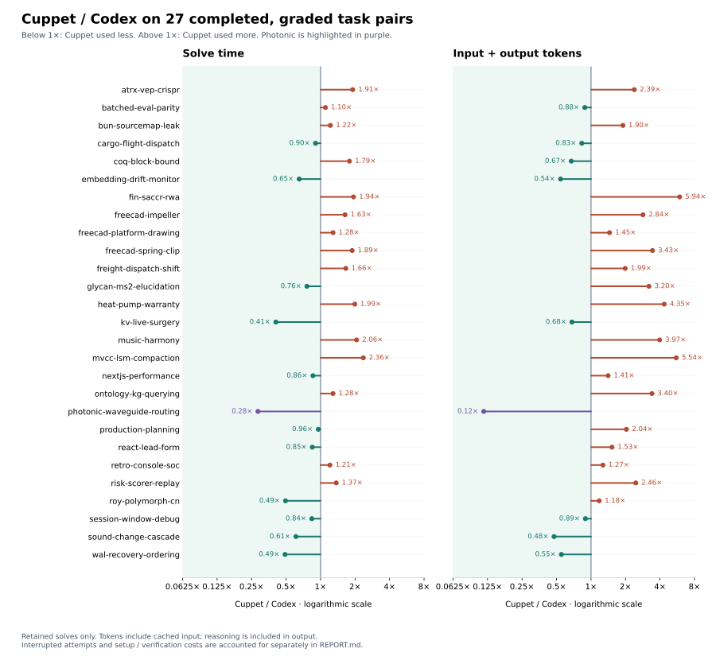

# Cuppet Desktop vs Codex: final Terminal-Bench 4 report

GPT-6 Luna, max reasoning, Codex subscription, local 29-task CPU subset. Completed 17 October 2026 at 08:37 IST.

## Findings

Cuppet finished with **4 passes, 25 graded failures and no infrastructure errors**. Codex finished with **3 passes, 24 graded failures and 2 infrastructure errors**. This is one additional pass across the selected 29 tasks, a difference of 3.45 percentage points. These are retained final results after documented recovery, rather than clean first-attempt scores.

On the 27 tasks graded by both harnesses, Cuppet used **22.8% less agent solve time and 24.3% fewer total tokens**. The large photonic solve changes the aggregate: without it, Cuppet took **20.9% more solve time and 12.2% more total tokens**. Cuppet was faster on 12/27 paired tasks and used fewer total tokens on 9/27. The median paired ratios were 1.21× time and 1.53× tokens.

Across all selected tasks and recorded recovery attempts, measured trial wall time was almost identical: about **16h40m Codex and 16h42m Cuppet**. Cuppet used fewer raw tokens including cache, but more uncached input and output. The data supports a task-dependent difference in behavior; it does not establish a consistent speed, token, or quality improvement.

## Final outcomes

| Harness | Pass | Graded fail | Infrastructure error | Selected tasks | Pass / selected |
| --- | --- | --- | --- | --- | --- |
| Codex | 3 | 24 | 2 | 29 | 10.34% |
| Cuppet | 4 | 25 | 0 | 29 | 13.79% |

Both harnesses passed photonic-waveguide-routing. Cuppet additionally passed coq-block-bound, heat-pump-warranty, and mvcc-lsm-compaction. Codex additionally passed kv-live-surgery and react-lead-form.

The two Codex infrastructure failures were foodstuff-beta-activity (`NonZeroAgentExitCodeError`, installation failed before model execution) and vllm-deepseek-streaming (`EnvironmentStartTimeoutError`, environment startup exceeded its budget). They remain errors, rather than graded model failures. Cuppet reached grading on both and received zero reward.

## Experiment and scope

| Setting | Recorded configuration |
| --- | --- |
| Dataset | terminal-bench/terminal-bench@4.0.0 |
| Scope | 29 of 66 versioned tasks; no GPU, at most 2 CPUs and 4096 MB RAM |
| Model / reasoning | gpt-6-luna / max |
| Provider / authentication | Official Codex subscription authentication |
| Codex runtime / Harbor | 0.162.1 / 0.24.0 |
| Benchmark Python | 3.12.4 |
| Cuppet revision | 58270905de9e794f12c6dcf6b26e07a069e462ed |
| Native TST revision | 9f2a8ae63555b7534ee1ccfe211efce1ad46f630 |
| Host | Apple Silicon arm64, 8 GiB RAM |
| Dedicated VM | Colima benchmark profile; 2 CPUs, 4 GiB RAM, 25 GiB virtual disk; native aarch64 |
| Task platform | Linux amd64, VZ/Rosetta compatibility |
| Ordering / concurrency | All Codex tasks first, then all Cuppet tasks; one task at a time |
| Per-job attempts | 1; manual infrastructure recoveries and interruptions listed separately |
| Task solve budget | Original task definitions, 28,800 seconds (8 hours) per agent attempt |
| Installation budget | Originally 360 seconds; increased to 1,800 seconds for both harnesses |
| Built-in web search | Disabled |
| Cuppet policy | Optimized execution, native managed TST, normal context/plans/memory/kernel; background enrichment paused |

Cuppet ran the unmodified runtime process used by its Electron desktop app inside the Linux task container. Its desktop window and Windows packaging were outside this evaluation. Cuppet's provider used the pinned Codex app-server; the baseline used Harbor's standard Codex loop with a small credential-ownership adapter.

Each task used a fresh container, agent session, and Cuppet data directory. Task instructions, checksums, model selection, reasoning effort, and solve budgets were preserved. The host, Docker image cache, VM, subscription account, and fixed harness ordering were shared.

This is a local resource-filtered subset report, not an official full Terminal-Bench leaderboard score. No GPU tasks or cloud sandbox were used.

## Measurement definitions

- **Agent solve time:** Harbor's `agent_execution` interval, including model responses, tools, native graph work, and waits. It is not isolated model-compute time.
- **Setup:** environment startup plus agent installation. **Verification:** the recorded official verifier interval. **Trial wall time:** the complete trial duration, including artifact handling and gaps between phases.
- **Retained results:** one final result for each selected task, following a regrade back to its original solve. A regrade adds verifier/wall time but does not add model time or usage again.
- **All recorded attempts:** retained results plus superseded records, with regraded source trials deduplicated. This includes the two-hour interrupted Cuppet wait and earlier interrupted Codex model runs.
- **Token counts:** cumulative provider-reported input plus output. Cached input is already included in input. Reasoning output is already included in output. Neither subset is added a second time.
- **Matched comparison:** only the 27 tasks with a completed grade on both harnesses. The two Codex infrastructure failures are excluded from paired efficiency statistics, while remaining present in all-29 operational totals.

Codex counts were checked against its saved ATIF final metrics. Cuppet counts were checked against its saved runtime sample. Interrupted Cuppet Risk-scorer usage was recovered from the last cumulative provider event, which is a recorded lower bound. A failed Codex authentication execution had no reported token count. These counts do not describe the subscription's quota formula or actual dollar billing.

## Timing

**Matched 27 retained results**

| Metric | Codex | Cuppet | Cuppet change |
| --- | --- | --- | --- |
| Agent solve time | 11h 11m 59s | 8h 38m 45s | -22.8% |
| Environment + agent installation | 3h 11m 07s | 3h 17m 18s | +3.2% |
| Verification | 51m 32s | 55m 07s | +7.0% |
| Recorded trial wall time | 15h 21m 13s | 12h 58m 11s | -15.5% |

**All 29 selected tasks: retained trials, including infrastructure failures**

| Metric | Codex | Cuppet | Cuppet change |
| --- | --- | --- | --- |
| Agent solve time | 11h 11m 59s | 8h 55m 19s | -20.3% |
| Environment + agent installation | 3h 24m 00s | 3h 29m 03s | +2.5% |
| Verification | 51m 32s | 56m 09s | +9.0% |
| Recorded trial wall time | 15h 34m 19s | 13h 27m 59s | -13.5% |

**All 29 selected tasks: including superseded attempts**

| Metric | Codex | Cuppet | Cuppet change |
| --- | --- | --- | --- |
| Agent solve time | 11h 30m 38s | 11h 17m 24s | -1.9% |
| Environment + agent installation | 4h 09m 26s | 4h 19m 36s | +4.1% |
| Verification | 52m 11s | 56m 09s | +7.6% |
| Recorded trial wall time | 16h 40m 30s | 16h 41m 33s | +0.1% |

Measured trial wall time is the sum of recorded trial durations, rather than elapsed time between the first and last task. The difference captures pauses, image cleanup, and orchestration outside trial records.

| Timeline | Codex | Cuppet |
| --- | --- | --- |
| First recorded trial (IST) | 15 Oct 22:38:58 | 16 Oct 15:49:27 |
| Last recorded trial (IST) | 16 Oct 15:49:26 | 17 Oct 08:37:18 |
| Elapsed span | 17h 10m 29s | 16h 47m 50s |
| Outside recorded trials | 29m 59s | 6m 17s |
| Unique trial records, including regrades | 36 | 37 |

The complete coordinator sequence lasted **33h 58m 21s**, from 15 October 22:38:57 IST to 17 October 08:37:18 IST. Preflight and preparation were outside this sequence.

## Tokens

**Matched 27 retained results**

| Metric | Codex | Cuppet | Cuppet change |
| --- | --- | --- | --- |
| Input, including cached | 239.127M | 179.996M | -24.7% |
| Cached input (subset) | 232.585M | 172.608M | -25.8% |
| Uncached input | 6.542M | 7.388M | +12.9% |
| Output, including reasoning | 2.989M | 3.263M | +9.2% |
| Reasoning output (subset) | 2.414M | 2.700M | +11.8% |
| Total input + output | 242.116M | 183.259M | -24.3% |

| Matched-task cache / output composition | Codex | Cuppet |
| --- | --- | --- |
| Cached share of input | 97.26% | 95.90% |
| Reasoning share of output | 80.78% | 82.76% |
| Uncached input + output | 9.531M | 10.650M |

**All 29 selected tasks, including superseded attempts: recorded token totals**

| Metric | Codex | Cuppet | Cuppet change |
| --- | --- | --- | --- |
| Input, including cached | 241.127M | 189.855M | -21.3% |
| Cached input (subset) | 234.400M | 181.954M | -22.4% |
| Uncached input | 6.727M | 7.901M | +17.5% |
| Output, including reasoning | 3.093M | 3.452M | +11.6% |
| Reasoning output (subset) | 2.509M | 2.857M | +13.9% |
| Total input + output | 244.221M | 193.307M | -20.8% |

The lower raw total should not be read as lower fresh-token generation: Cuppet's matched uncached input was higher, and so was its output. Much of both harnesses' raw usage was reused input context. No comparable monetary-cost figure is available: Harbor's Codex `cost_usd` is an estimate, Cuppet's field is null, and neither is a subscription charge ledger.

## Per-task results, solve times, and tokens

Times and usage below are for the retained solve. Error rows did not reach model execution. Tokens are input plus output, including cached input. `Error` is separate from a graded `Fail`.

| Task | Grade Codex / Cuppet | Codex solve | Cuppet solve | Codex trial | Cuppet trial | Codex tokens | Cuppet tokens |
| --- | --- | --- | --- | --- | --- | --- | --- |
| atrx-vep-crispr | Fail / Fail | 10m 39s | 20m 20s | 23m 34s | 31m 11s | 2.409M | 5.746M |
| batched-eval-parity | Fail / Fail | 12m 48s | 14m 06s | 20m 50s | 22m 53s | 4.509M | 3.978M |
| bun-sourcemap-leak | Fail / Fail | 3m 38s | 4m 25s | 10m 52s | 12m 54s | 0.383M | 0.728M |
| cargo-flight-dispatch | Fail / Fail | 4m 38s | 4m 11s | 10m 08s | 10m 21s | 0.615M | 0.511M |
| coq-block-bound | Fail / Pass | 1h 00m 32s | 1h 48m 13s | 1h 09m 27s | 2h 03m 31s | 74.655M | 50.198M |
| embedding-drift-monitor | Fail / Fail | 6m 35s | 4m 17s | 18m 47s | 11m 55s | 1.148M | 0.622M |
| fin-saccr-rwa | Fail / Fail | 9m 05s | 17m 37s | 14m 32s | 23m 44s | 0.701M | 4.163M |
| foodstuff-beta-activity | Error / Fail | — | 12m 23s | 3m 05s | 18m 25s | — | 3.880M |
| freecad-impeller | Fail / Fail | 5m 40s | 9m 16s | 15m 35s | 32m 31s | 0.896M | 2.543M |
| freecad-platform-drawing | Fail / Fail | 6m 08s | 7m 53s | 16m 15s | 21m 40s | 1.217M | 1.766M |
| freecad-spring-clip | Fail / Fail | 10m 47s | 20m 20s | 20m 44s | 37m 36s | 2.595M | 8.914M |
| freight-dispatch-shift | Fail / Fail | 10m 50s | 17m 59s | 16m 52s | 23m 43s | 2.653M | 5.268M |
| glycan-ms2-elucidation | Fail / Fail | 4m 39s | 3m 32s | 11m 41s | 14m 51s | 0.410M | 1.311M |
| heat-pump-warranty | Fail / Pass | 6m 33s | 13m 03s | 13m 11s | 19m 22s | 1.819M | 7.909M |
| kv-live-surgery | Pass / Fail | 27m 48s | 11m 19s | 38m 14s | 24m 28s | 7.788M | 5.308M |
| music-harmony | Fail / Fail | 7m 36s | 15m 39s | 12m 58s | 23m 23s | 1.811M | 7.189M |
| mvcc-lsm-compaction | Fail / Pass | 1m 38s | 3m 53s | 12m 13s | 17m 05s | 0.179M | 0.992M |
| nextjs-performance | Fail / Fail | 6m 05s | 5m 13s | 18m 25s | 18m 48s | 0.854M | 1.204M |
| ontology-kg-querying | Fail / Fail | 8m 46s | 11m 15s | 15m 15s | 16m 44s | 1.604M | 5.457M |
| photonic-waveguide-routing | Pass / Pass | 5h 17m 33s | 1h 30m 18s | 5h 27m 55s | 1h 38m 26s | 87.893M | 10.179M |
| production-planning | Fail / Fail | 12m 52s | 12m 18s | 18m 26s | 20m 06s | 1.305M | 2.657M |
| react-lead-form | Pass / Fail | 10m 38s | 9m 01s | 18m 10s | 16m 13s | 2.171M | 3.311M |
| retro-console-soc | Fail / Fail | 27m 36s | 33m 19s | 39m 19s | 39m 38s | 17.384M | 22.075M |
| risk-scorer-replay | Fail / Fail | 27m 54s | 38m 12s | 34m 10s | 44m 16s | 9.036M | 22.215M |
| roy-polymorph-cn | Fail / Fail | 3m 24s | 1m 41s | 10m 16s | 8m 58s | 0.275M | 0.324M |
| session-window-debug | Fail / Fail | 3m 50s | 3m 13s | 11m 14s | 11m 18s | 0.410M | 0.366M |
| sound-change-cascade | Fail / Fail | 58m 11s | 35m 28s | 1h 04m 53s | 42m 14s | 16.692M | 7.938M |
| vllm-deepseek-streaming | Error / Fail | — | 4m 11s | 10m 01s | 11m 23s | — | 2.078M |
| wal-recovery-ordering | Fail / Fail | 5m 37s | 2m 45s | 37m 17s | 10m 21s | 0.704M | 0.388M |

## Task variation and the photonic effect



Ratios below 1 favor Cuppet for that resource; ratios above 1 mean Cuppet used more. These are resource comparisons and do not imply a pass on the task.

Photonic passed on both harnesses: Codex took 5h17m33s and 87.893M tokens; Cuppet took 1h30m18s and 10.179M tokens. Its saved Cuppet output was regraded after a verifier download failure, without a new model solve. This one task changes the direction of the aggregate comparison.

| Metric | Codex | Cuppet | Cuppet change |
| --- | --- | --- | --- |
| Agent solve time | 5h 54m 26s | 7h 08m 27s | +20.9% |
| Total input + output | 154.223M | 173.080M | +12.2% |

Across the 27 pairs, the median Cuppet/Codex task ratio was **1.207× time** and **1.525× total tokens**. Cuppet was faster on 12 tasks and slower on 15; it used fewer raw tokens on 9 and more on 18. Cuppet's additional passes involved more solve time on Coq, Heat-pump, and MVCC. Conversely, its shorter KV solve failed where Codex passed.

## Tool activity and native runtime

These counters describe retained runs. The tools operate at different granularities, so call totals are not interchangeable measures of agent decisions or efficiency.

| Measurement | Codex | Cuppet |
| --- | --- | --- |
| Retained model traces | 27 | 29 |
| Recorded tool calls / attempts | 2078 | 5604 |
| Native TST connected | Not applicable | 29/29 |
| Executed / completed operations | Not normalized | 5538 / 5538 |
| Operation success / failure | Not normalized | 5404 / 134 |
| Cumulative tool duration | Not collected comparably | 34m 36s |
| Recorded tool output bytes | Not collected comparably | 20,176,881 |
| Recorded mutations | Not normalized | 65 |
| Local validation success / failure | Not normalized | 103 / 124 |

| Cuppet tool | Recorded attempts |
| --- | --- |
| cuppet_execute | 4530 |
| tst_read | 421 |
| tst_validate | 233 |
| tst_edit_batch | 169 |
| tst_explore | 168 |
| background_process | 83 |

| Codex tool | Recorded calls |
| --- | --- |
| exec | 2076 |
| sleep | 1 |
| wait | 1 |

Cuppet completed 5,538 executed operations with 5,404 recorded successes (97.58%). Tool success means the operation completed under the runtime's contract; it does not imply the benchmark task passed. Risk-scorer alone accounts for 3,747 of the 5,604 recorded Cuppet calls, about 66.9%, and still received zero reward. Codex's `exec` calls can each contain multiple operations, while Cuppet's execution kernel records finer-grained activity. Cumulative tool durations can overlap or include nested work; they are not an exclusive CPU-time partition.

## Recovery and retry accounting

Seven Codex records and eight Cuppet records are superseded in the checkpoint. One on each side is the original solve behind a regrade, rather than an extra model solve. There are 36 unique Codex trial records and 37 unique Cuppet trial records, excluding integration preflights.

| Extra superseded work, matched tasks | Codex | Cuppet |
| --- | --- | --- |
| Extra agent time | 18m 39s | 2h 22m 05s |
| Extra setup + verification | 46m 05s | 50m 33s |
| Extra recorded tokens | 2.105M | 4.091M |

- The installation budget was raised from 6 to 30 minutes after slow setup caused timeouts. Task-solving budgets were preserved.
- Codex batched-eval-parity completed a model solve before a verifier architecture problem. Its saved output was regraded after fixing the architecture setting; the final grade was zero. Its original model usage and solve time are counted once.
- Subscription authentication failed on a non-root task because copied credentials were owned by UID 501 and unreadable by the task's `nobody` user. The account credentials had not expired. Both adapters were corrected to assign the copied private credentials to the actual container UID; both non-root preflights passed afterward.
- Local network failures affected Cuppet image downloads. Heat-pump and KV were retried; their original failed setups never reached the model. Production-planning, React-lead-form, and Retro-console were also retried after failures before model execution. Photonic's existing output was regraded, rather than solved again.
- Codex Coq, KV, and Roy have earlier interrupted model executions. Cuppet Risk-scorer was explicitly interrupted after its output stopped and restarted in a fresh session. Its first execution spent 2h22m05s, with 4.091M tokens recorded before interruption. The retained retry failed grading.
- The later request to kill a task was clarified by the user as a status request. Retro-console was left running; no additional retry was made then.

Fresh containers and sessions prevented reuse of an interrupted solution's local state. Manual restarts still change the sampling and total-compute history, so these results should not be labeled clean pass@1. There is no evidence here of cross-harness state reuse or hidden-test feedback being supplied to a retry, but this run does not establish freedom from prior model training exposure to task material.

## Preflights and checks outside the score

The latest non-root Codex and Cuppet fixtures both passed before continuation. These checked real Luna/max read/edit/shell behavior and Cuppet's native graph connection. They are not benchmark tasks and are excluded from the score and main resource tables.

| Logged integration fixtures | Codex | Cuppet |
| --- | --- | --- |
| Recorded fixture trials | 3 | 5 |
| Recorded agent time | 1m 21s | 3m 17s |
| Recorded input + output | 0.107M | 0.416M |

| Additional host-only Cuppet fixture | Status | Recorded runtime | Input + output |
| --- | --- | --- | --- |
| host-cuppet | complete | 0m 30s | 0.121M |
| host-cuppet-retry | complete | 0m 34s | 0.119M |

These host fixtures consumed another 239,581 recorded tokens in total and are excluded from the benchmark comparison. This report does not include the tokens used by this conversation, unlogged diagnostic requests, or other activity on the shared subscription.

## Limits and unmeasured quantities

This was one local CPU subset run with fixed ordering, infrastructure repairs, and manual interruptions. There were no repeated independent runs or randomized harness ordering. The task count is small, most tasks failed, and one pass separates the harnesses. No broad superiority or official leaderboard ranking follows from this result.

Peak RAM, CPU utilization over time, energy, provider service latency, subscription quota debits, and actual monetary charges were not recorded comprehensively. VM allocations are configuration limits, not measurements of consumption. The end-to-end agent times include tools, code execution, compatibility overhead, and idle waits, so they do not isolate model generation speed.

## Evidence and reproduction

- [Final result summary](RESULTS.md), [run settings](settings.json), [selected-task manifest](configs/local-cpu-tasks.json), [setup and integration details](README.md).
- Local machine-readable measurements: `reports/final-metrics.json`; final checkpoint and trial references: `reports/comparison.json`; credential/regrade/retry audit records are retained locally.
- Raw job logs, trajectories, artifacts, and supporting metadata are preserved in the verified local archive `reports/benchmark-evidence-20261017.tar.gz`. The archive and raw logs are excluded from Git. `reports/benchmark-evidence-20261017.tar.gz.sha256` and `reports/evidence-manifest.json` provide its hash and file verification results.
- Recover raw records and host fixtures, then regenerate statistics without Docker or model calls:

```sh
tar -xzf reports/benchmark-evidence-20261017.tar.gz jobs reports/host-cuppet reports/host-cuppet-retry
python3 scripts/report-results.py
```

Re-running model evaluations requires rebuilding the dedicated environment with `./scripts/setup-mac.sh`, authenticating through the existing Codex subscription, and explicitly starting the requested tasks. Regenerating this report does not re-run an agent.

Pinned native TST SHA-256: `1fe944980bc3e47791e79f9e00d6802efd1bc226073abab6c235a6ca83b26b1b`. Runtime bundle SHA-256: `661e933b46499808f1c046dabea3f02089183548b784a11b34e3ddbe1a9b1dd8`.

Cleanup status and storage accounting are recorded in `reports/cleanup.json`.

## Cleanup completed

The dedicated Colima benchmark VM and its container data were deleted, including the remaining 13 images and 35 build-cache records. No containers or volumes remained before teardown. The benchmark Docker context was removed, the CLI was returned to `default`, and the existing Docker Desktop context was preserved. The completed benchmark monitor was removed.

The dataset/build/source caches, isolated `.venv`, temporary research files, unpacked job directories, and host/native test workspaces were removed. Shared command-line tools, the existing Codex login, and the user's Cuppet checkout were retained.

All 3,523 archive entries were verified against their originals, including SHA-256 for every regular file. The archive preserves all 81 logged benchmark/preflight trial records. Its size is 133.8 MiB. The removed paths formerly accounted for approximately 2.72 GiB of allocated files/VM storage; this is a `du` footprint, not a measured net free-space increase and may include shared/hardlinked blocks.

Archive SHA-256: `614ca7110e6dd6571c39bbc7c25b38dfec528b4fd7e0da9b4d98eb06e3b2f5e1`.
